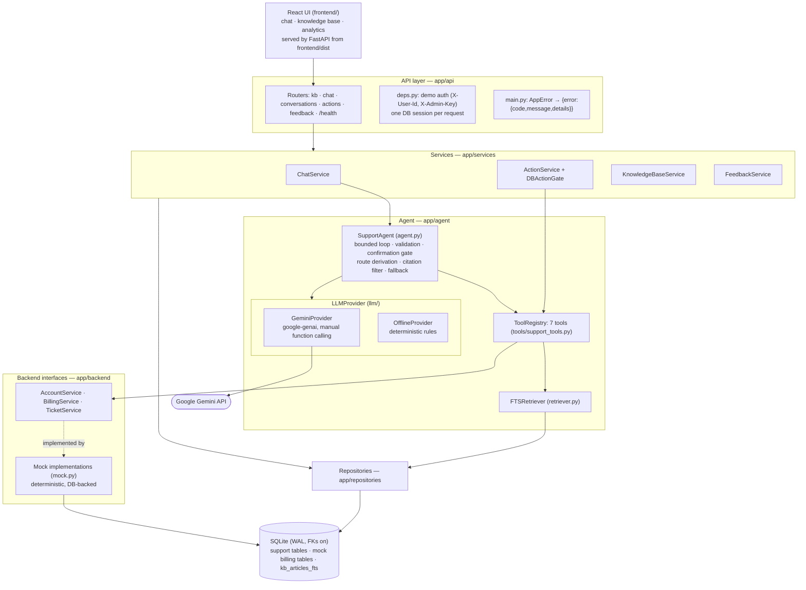
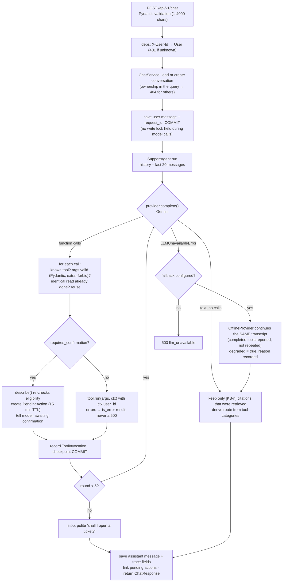
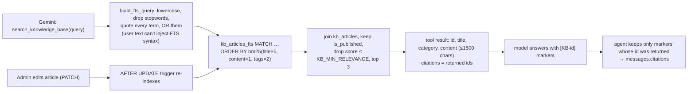
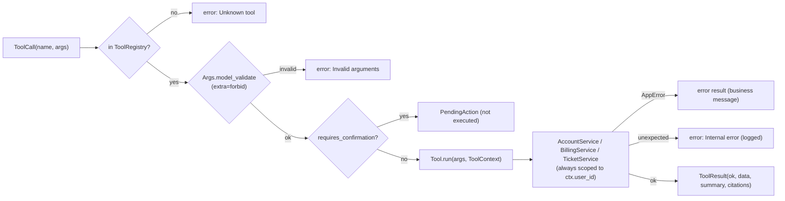
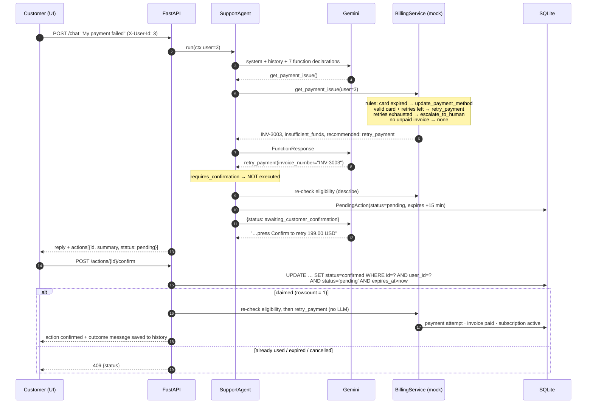
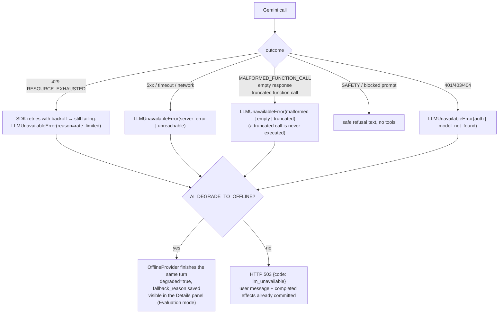

# Architecture

All diagrams reflect the code as it is. File and class names are given so each box can be traced
to its implementation.

## 1. Components

`app/container.py` is the composition root: it chooses the provider from configuration
(`build_providers`) and builds per-request services. Nothing else instantiates concrete classes.

## 2. Agent execution flow (one chat turn)

Limits per turn: at most 5 tool rounds, so at most 6 model calls. The SDK retries 429/5xx up to
`GEMINI_MAX_RETRIES` times with backoff, under a `GEMINI_TIMEOUT_SECONDS` timeout.

## 3. Knowledge retrieval

## 4. Backend tool execution

Tool categories (`knowledge`, `read`, `action`, `escalation`) drive the route label and the
"reuse identical reads" optimisation.

## 5. Payment failure and confirmation

## 6. Fallback and failure handling

Startup: `AI_PROVIDER=gemini` without `GEMINI_API_KEY` raises `ConfigurationError` immediately;
`AI_PROVIDER=auto` without a key runs offline.
