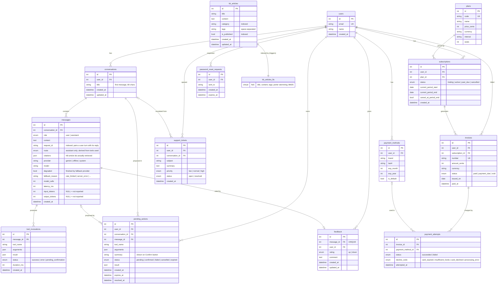

# Database schema

SQLite by default (`DATABASE_URL` can point at Postgres; the models use only portable types).
Tables are created on startup by `init_db()` (`app/db.py`); enums are stored as strings and
timestamps in UTC. Connection settings: `PRAGMA foreign_keys=ON`, WAL journal mode, 15 s busy
timeout. After a schema change, run `make reset` locally (no migrations; Alembic in production).

There are two groups of tables:

* **Support domain** (owned by this service): knowledge base, conversations, messages, the agent's
  audit trail, pending actions, feedback.
* **Mock SaaS backend** (would be other systems in production: identity provider, billing
  platform, helpdesk). They share the database only for convenience; the agent reaches them
  exclusively through the interfaces in `app/backend/interfaces.py`.

## Constraints and indexes

| Table | Constraint / index | Purpose |
|---|---|---|
| `users` | `UNIQUE(email)` | one account per email |
| `plans` | `UNIQUE(code)` | stable plan identifiers |
| `invoices` | `UNIQUE(number)`, index on `user_id`, `subscription_id` | invoice lookup by customer-visible number |
| `feedback` | `UNIQUE(message_id)` | one rating per answer; `PUT` replaces it |
| `kb_articles` | index on `category`, `is_published` | admin filtering, published-only search |
| `messages` | index on `conversation_id`, `route`, `request_id` | history, analytics, trace lookup |
| `tool_invocations` | index on `message_id`, `tool_name` | trace and per-tool analytics |
| `pending_actions` | index on `user_id`, `conversation_id`, `status` | ownership checks, open actions |
| all `*_id` foreign keys | enforced (`foreign_keys=ON`) | ownership chain user → conversation → message |

Cascades: deleting a conversation removes its messages (ORM cascade), their tool invocations and
feedback, and its pending actions (`ON DELETE CASCADE`). Support tickets survive with
`conversation_id` set to NULL, because the human follow-up must not disappear (tested).

## Transaction design

- **One session per HTTP request** (`app/api/deps.py`): committed on success, rolled back on error.
- **Chat turns commit in steps** (`ChatService.send_message`): the user message is committed before
  the first Gemini call, and the agent commits after every tool round (`checkpoint`). SQLite has a
  single writer, and a model call takes seconds, so no write lock is held while waiting on Gemini.
  Side effects of completed tools are durable even if a later model call fails.
- **Atomic statements where races matter:**
  - confirmation claim: `UPDATE pending_actions SET status='confirmed' WHERE id=? AND user_id=? AND status='pending' AND expires_at>now` (rowcount decides the winner);
  - password-reset cooldown: `INSERT … SELECT … WHERE NOT EXISTS (reset in last 10 min)`.

## Modelling notes

* **Money in integer cents** plus an ISO currency code, never floats.
* **`messages` stores how each answer was made** (request id, route, citations, provider, model,
  model calls, tokens, latency, degraded flag and reason). Together with `tool_invocations` this
  is the audit trail: for any answer you can see which tools ran, with which arguments, and what
  they returned. Missing token counts are stored as NULL, never as 0.
* **`feedback.message_id` is UNIQUE**: one rating per answer; re-rating replaces it (PUT is
  idempotent). Feedback joins to `messages.route`, so satisfaction can be broken down by how
  the agent answered.
* **`pending_actions`** persist the exact arguments the user approves; confirmation replays those
  arguments, not a new model output. Status changes are single-use, so a double click cannot
  double-charge.
* **Invoice → payment_attempts** models dunning: the number of failed attempts drives
  `retries_remaining`, and the decline code drives the recommended next step.
* **FTS index sync** happens in SQLite triggers (`AFTER INSERT/UPDATE/DELETE ON kb_articles`), so
  every write path, ORM or raw SQL, keeps search consistent.
* **Deletion:** deleting a conversation cascades to messages, tool invocations, feedback and
  pending actions; tickets keep their row (`conversation_id` set to NULL).
